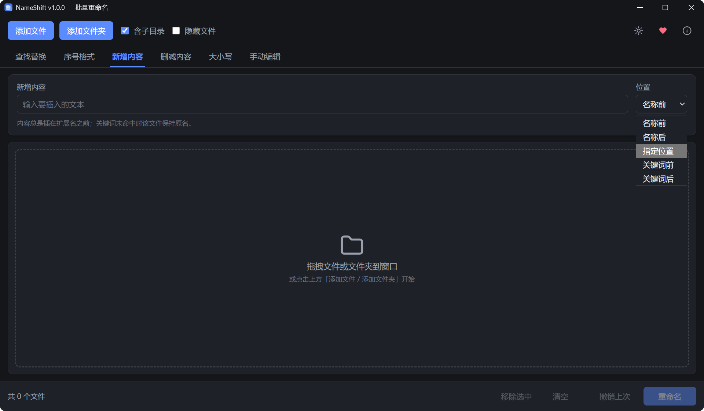
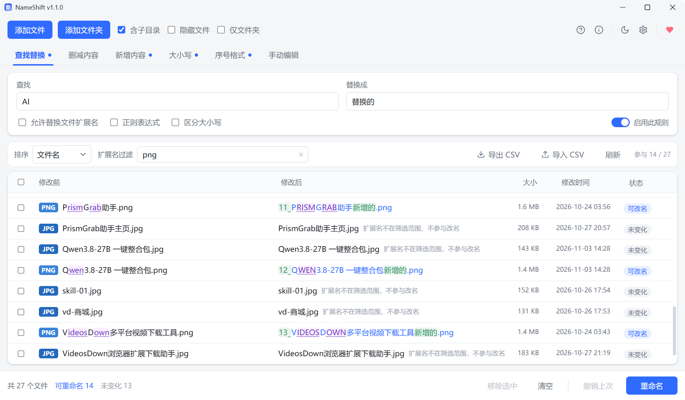

<div align="center">


# NameShift

**一款轻量的跨平台批量重命名工具**

基于 Tauri 2 + Vue 3 + TypeScript + Rust 构建，支持 **Windows 与 macOS**。
项目以"学习规范的桌面应用分层架构"为首要目标，前后端职责严格分离。

[](https://v2.tauri.app/)
[](https://vuejs.org/)
[](https://www.typescriptlang.org/)
[](https://www.rust-lang.org/)
[](https://pinia.vuejs.org/)
[](https://vitejs.dev/)
[](https://vitest.dev/)

[](#)
[](#)
[](#测试)
[](#许可)

**🚧 源码整理中，即将开源**

</div>

---

## ✨ 功能总览

### 六大重命名模式

| 模式 | 能力 |
|---|---|
| **查找替换** | 纯文本替换（全部命中）；正则表达式模式（支持 `$1` 捕获组）；区分大小写开关；扩展名默认保护，可选一并替换 |
| **删减内容** | 四种子操作——**按位置**（删开头/结尾 N 个字符）、**按范围**（删第 M~N 个字符）、**按关键词**（全部 / 仅第一处 / 仅最后一处，可区分大小写）、**按类型**（删数字 / 英文字母 / 空格） |
| **序号格式** | 模板占位符 `{index}`（序号）、`{name}`（原名）；起始编号 / 步长 / 位数补零（0–6 位）；"每个文件夹重新计数"（多目录导入时目录内独立编号） |
| **新增内容** | 五种插入位置——名称前 / 名称后 / 指定字符位置 / 关键词前 / 关键词后（忽略大小写取第一处）；始终插在扩展名之前 |
| **大小写** | 全部大写 / 全部小写 / 每词首字母大写；可选包含扩展名 |
| **手动编辑** | 在预览表"修改后"列直接逐行输入，支持单行还原与一键全部还原 |

> 序号按 **自然排序** 分配（`第2集` 排在 `第10集` 之前），各模式参数独立保存、互不覆盖，并自动记忆到本地。

### 🔒 安全与效率

- **实时预览**：任何参数改动立刻刷新"修改前 → 修改后"，逐行标注状态（可改名 / 未变化 / 冲突 / 非法）
- **冲突检测**：批次内撞名、与目录内现有文件重名（统一忽略大小写，兼容 Win/mac 默认文件系统）
- **非法名校验**：按当前系统校验非法字符（Windows `\ / : * ? " < > |`、macOS `/ :` 等）；Windows 保留设备名（CON、NUL、COM1-9…）与尾随点/空格；在非 Windows 平台上对含 Windows 非法字符的名字给出**跨平台可移植性警告**
- **扩展名保护**：文本类模式默认只处理主文件名，勾选后才允许改动扩展名
- **两阶段事务执行**：目标名冲突的操作先挪临时名再落最终名（支持 `A↔B` 互换、仅大小写改名）；任一步失败自动**逆序回滚**，目录保证回到初始状态
- **一键撤销**：会话内可连续撤销最近几次批次，部分失败自动保留待重试

### 📂 文件导入

- 全窗口**拖拽**导入，或按钮选择文件 / 文件夹
- 文件夹支持**递归子目录**与**包含隐藏文件**开关
- 重复路径自动去重；文件按目录分组、目录内自然排序展示

### 🎨 体验细节

- **暗色 / 亮色主题**：首次启动跟随系统偏好，一键切换并记忆；原生标题栏与应用主题同步（Windows 11 DWM 精确着色 / macOS 原生标题栏）
- **macOS 本地化**：应用菜单栏（文件/编辑/显示/窗口/帮助）按默认结构以中文重建，右键菜单等系统文案按系统语言显示
- **界面图标全矢量**：SVG 图标（`AppIcon.vue`），不依赖系统字体字形，两平台渲染一致
- **窗口在鼠标所在屏幕居中打开**（多显示器友好，无位置跳闪）
- 版本号显示在窗口标题与"关于"弹窗
- 全部参数与导入选项自动持久化

## 🖼 界面预览

启动后即见：顶部为导入操作与主题/更多菜单，模式标签页切换六种规则，中间大表为"修改前 / 修改后"实时预览，底部按作用域分组的操作区（清单操作 │ 撤销 / 重命名）。

| 查找替换（亮色主题） | 新增内容 · 插入位置（暗色主题） |
|:---:|:---:|
|  |  |

**实时预览与状态标注**——逐行显示"修改前 → 修改后"，右列标注该行是否可改名：



## 🛠 技术栈

| 层次 | 技术 | 说明 |
|---|---|---|
| 桌面框架 | [Tauri 2](https://v2.tauri.app/) | 轻量壳 + 系统 WebView，产物体积远小于 Electron |
| 前端框架 | [Vue 3.5](https://vuejs.org/) `<script setup>` | 组合式 API |
| 状态管理 | [Pinia 4](https://pinia.vuejs.org/) | files / rules / theme / app / toast 五个 store |
| 语言 | TypeScript 6 + Rust | 前端类型完备，后端安全系统级执行 |
| 构建 | [Vite 8](https://vitejs.dev/) | 开发热更新 + 生产构建 |
| 测试 | [Vitest 5](https://vitest.dev/) / `cargo test` | 前端 79 例 + 后端 26 例 |
| 插件 | `@tauri-apps/plugin-dialog` / `plugin-opener` | 系统对话框与打开文件/目录 |

## 🚀 开发

```bash
npm install          # 安装前端依赖
npm run tauri dev    # 启动桌面应用（自动起 Vite + cargo run）
npm run test         # 前端核心层单测（Vitest）
npm run build        # 类型检查 + 生产构建
cd src-tauri && cargo test   # Rust 后端单测
```

> 只想起浏览器里调 UI？直接 `npm run dev`，应用会自动使用 mock 后端（`src/services/mock.ts`），
> 内置一组示例文件，无需 Rust 环境。

> **编译产物位置**：Rust 产物与前端构建输出统一在源码树外的 `G:\My_Develop\NameShift\build\`
> （`target\` 与 `dist\`），由父级 `.cargo/config.toml` 的 `target-dir` 和 `vite.config.ts` 的
> `outDir` 指定；删除父级 `.cargo` 目录即回退到默认的 `src-tauri/target`。

## 🏗 架构（学习重点）

```
┌─ 前端 src/ ─────────────────────────────────────┐
│ components/   纯展示组件（工具栏/标签页/面板/表格/底栏）│
│ stores/       Pinia：files(清单) rules(参数) theme(主题) app(元信息) toast
│ composables/  组合逻辑：usePreview useRename useDragDrop
│ services/     IPC 唯一边界：ipc.ts(契约) tauri.ts(真实现) mock.ts(浏览器)
│ core/         纯函数领域层，不依赖 Vue/Tauri        │
│   rules/      六个模式各一个纯函数，统一签名         │
│   validate.ts 校验；preview.ts 编排规则+校验        │
│ types/        领域与 DTO 类型                       │
└──────────────────────────────────────────────────┘
                 ↕ invoke（camelCase DTO）
┌─ 后端 src-tauri/src/ ────────────────────────────┐
│ commands.rs  Tauri 命令薄壳（只转发）               │
│ fs_ops.rs    目录扫描（递归/隐藏/占用名）            │
│ rename.rs    两阶段执行器 + 失败回滚                │
│ journal.rs   撤销日志栈                            │
│ titlebar.rs  标题栏主题化（深浅 + Win11 精确色）     │
│ menu.rs      macOS 应用菜单栏（中文重建默认结构）    │
│ validate.rs  合法性二次校验（真正的安全边界）         │
│ error.rs     可序列化统一错误                      │
└──────────────────────────────────────────────────┘
```

### 关键设计决策

1. **前端算预览、Rust 执行改名**。预览走纯函数（`core/`），敲键盘零延迟刷新；
   Rust 在执行前用同一套规则**二次校验**——前端校验只管体验，不是安全边界。
2. **文件名拆成 `stem + ext` 处理**，规则函数统一签名
   `(ctx: {stem, ext, dirIndex, globalIndex}, params) => {stem, ext}`。
   新增模式 = 新增一个纯函数 + `RuleParams` 加字段 + `rules/index.ts` 注册三步
   （"删减内容"模式即是按此三步接入的，后端零改动）。
3. **两阶段重命名**（`rename.rs`）：先给"目标位被占用"（磁盘已有文件，或目标是批次内
   其他操作的源名）的操作改临时名 `~ns_tmp_<uuid>`，第二阶段统一落到最终名；
   每一步都记入回滚日志，失败时逆序还原，目录保证回到初始状态。
4. **IPC 契约化**（`services/ipc.ts`）：store 只依赖接口。浏览器里自动切到 mock 实现，
   UI 可以脱离 Rust 独立调试 / 自动化测试。
5. **占用名动态腾挪**：预览时"本批次即将改走"的名字会从占用集合中扣除，
   所以 A→B、B→A 互换和仅大小写改名都能正确放行。

### 🧪 测试

- 前端：**79** 个 Vitest 用例覆盖六个规则、文件名拆分、校验与预览编排（含互换、批次撞名、
  未变化文件占位等边界）。
- 后端：**26** 个 cargo test 覆盖扫描、执行器（成功/互换/仅大小写/冲突回滚/批次重名/撤销）。

## 📦 打包

```bash
npm run dist          # 统一发布入口（两平台同名命令）：构建 + DMG（仅 macOS）+ 产物重命名
```

产物位于 `build/target/release/bundle/`，统一命名为 **NameShift-{版本}-{平台}-{架构}**：

| 平台 | 产物 |
|---|---|
| Windows（NSIS） | `NameShift-1.0.0-Windows-x64.exe` |
| macOS | `NameShift-1.0.0-MacOS-arm64.dmg`（及 `macos/NameShift.app`） |

- 打包目标：Windows `["nsis"]`；macOS 由 `tauri.macos.conf.json` 覆盖为 `["app", "dmg"]`
- **DMG 图标大小 96**：Tauri 的 dmg 打包脚本每次构建都会重新生成、图标大小硬编码 128
  且无配置项，故 `scripts/dmg/` 入库自持该脚本（与官方生成版的差异仅 ICON_SIZE 一处），
  流程为 `tauri build --bundles app` 出 .app → `scripts/make-dmg.mjs` 按 bundler 相同
  参数生成 DMG
- 产物重命名：`scripts/rename-artifacts.mjs`（Tauri v2 无构建后钩子、无命名模板）
- macOS 双架构：`rustup target add aarch64-apple-darwin x86_64-apple-darwin` 后
  `npm run dist -- --target universal-apple-darwin`

### 跨平台构建迁移清单

把源码放到对应平台上构建（Windows / macOS 各自构建各自的包，无法交叉编译）：

1. 只拷源码目录；**不要拷** `node_modules\`（平台相关，到新平台重新 `npm install`）与 `build\`（旧平台产物）
2. **父目录的 `.cargo\config.toml` 记得一起带**，放到项目目录的上一级——它负责把编译产物迁出源码树；
   不带也能构建（自动回退到项目内 `src-tauri/target`），只是源码树会再次出现 `target` 目录
3. macOS 前置一次性安装：Node.js、Rust（rustup）、`xcode-select --install`；macOS 打包用系统内置
   hdiutil，无需下载 WiX/NSIS
4. Windows 首次打**安装包**需联网下载 NSIS 工具集（GitHub）；仅编译 exe 可用
   `npm run tauri build -- --no-bundle` 跳过
5. 分发给他人的 macOS 应用需要 Apple 开发者证书签名与公证；本机使用未签名的 .app 右键打开即可

## 📄 许可

供学习与个人使用，永久免费。
